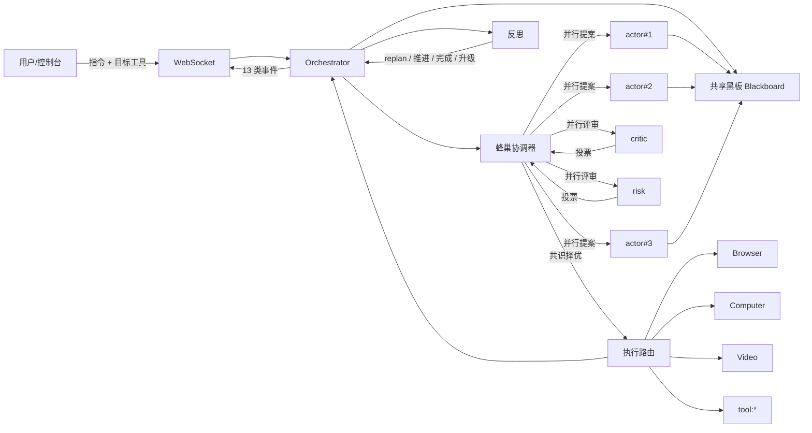

# 01 · 产品与架构总览

## 产品定位

ZHULI 是一个**运行在本机的 AI 助理**，形态为「本地服务 + 网页控制台」：

- 本地启动 Python 服务（FastAPI + WebSocket）；
- 用户在浏览器打开控制台下达自然语言指令；
- AI 在一个**独立弹出的 headed Chromium 窗口**中操作（与日常浏览器完全隔离）；
- 全过程「看得见」：截图流、元素高亮、动作日志、命令/终端输出、思维链、智能体活动。

对标 Muse：不仅有自主执行能力，还具备**长期记忆 + 自进化技能 + 蜂巢式群体决策**。

## 四类可编排能力

| 能力 | 说明 | 模块 |
|---|---|---|
| Browser | 隔离 headed Chromium、元素标注高亮、动作执行、敏感操作识别 | `browser/` |
| Computer | 本地命令执行（参数列表 + 危险命令护栏 + 输出回流） | `computer/` |
| Video | ffmpeg 剪辑方案规划 + 白名单命令执行 | `video/` |
| Integrations | CodeBuddy / Trae / OpenCode 连接器（复用上述能力） | `integrations/` |

## 整体架构

```
用户指令（可指定目标工具）
   │
   ▼
控制台（FastAPI + WebSocket 推送 13 类事件）
   │
   ▼
Orchestrator 主循环 ── 观察 → 决策 → 执行 → 反思 → （必要时重规划）
   │
   ├── 调度：Coordinator（多智能体） / HiveCoordinator（蜂巢共识）
   │        ├── planner      规划（子任务 + 达成标准 + 工具）
   │        ├── observer     观察蒸馏（剔除无关元素）
   │        ├── actor        N 个执行体并行提案（蜂巢时 N>1）
   │        ├── critic       执行前审查 / 执行后反思
   │        ├── risk         风险分级
   │        └── skill_miner  技能挖掘与迭代
   │
   ├── 执行路由：browser / computer / video / tool:*
   ├── 安全：规则护栏 + 风险智能体 + 不安全即确认
   ├── 凭据：安全卡片（明文不进 LLM，SecureString 密文持有）
   └── 记忆：SQLite（技能 / 任务 / 反思 / 键值）+ 技能升格
```

## 数据流（含蜂巢）



## 三个核心设计理念

### 1. 分层决策（规划与执行解耦）
Planner 只负责「拆目标 + 定完成标准」，Orchestrator 只负责「一步步推进」，
Reflection 只负责「判定达成与否」。职责分离让复杂任务更稳，也让每个环节可独立替换。

### 2. 多智能体 + 蜂巢思维
不是「一个大脑干所有事」，而是多个专精智能体协作；
蜂巢模式下更进一步：**多个执行体并行提案 → 评审者并行投票 → 共识择优**。
个体失效不影响整体，群体判断优于单体。

### 3. 自进化（越用越聪明）
- 成功任务 → 提炼为技能 → 存入 SQLite；
- 新任务 → 检索（语义/关键词）复用技能；
- 技能复用达标 → 自动升格为专项智能体，成为团队新模块；
- 技能被再次使用 → 合并新经验，自动迭代精炼。

## 与「单体 Agent」的差异

| 维度 | 单体 Agent | ZHULI |
|---|---|---|
| 决策 | 一次调用产出一个动作 | 多智能体分工 + 蜂巢共识 |
| 纠错 | 靠重试 | 执行前批评 + 确定性循环检测 + 重规划 + 升级 |
| 经验 | 无 | SQLite 技能库 + 自动迭代 + 技能升格为智能体 |
| 模型 | 单一模型 | 每个智能体可绑不同 provider/capability |
| 可观测 | 有限 | 13 类事件：思维链 + 智能体活动 + 投票过程 |
| 安全 | 视实现 | 规则护栏 + 风险智能体 + 军事级加密 |

## 运行时产物位置

全部落在项目内 `.zhuli_runtime/`，**绝不写入 C 盘**：

- `.zhuli_runtime/browsers/` —— Chromium 二进制
- `.zhuli_runtime/profile/` —— 浏览器用户 profile（与日常浏览器隔离）
- `.zhuli_runtime/venv/` —— 项目内虚拟环境
- `.zhuli_runtime/memory.db` —— 长期记忆数据库

## 下一步

- 想找代码 → [02-目录结构与模块职责](02-目录结构与模块职责.md)
- 想改决策 → [03-决策链](03-决策链.md)
